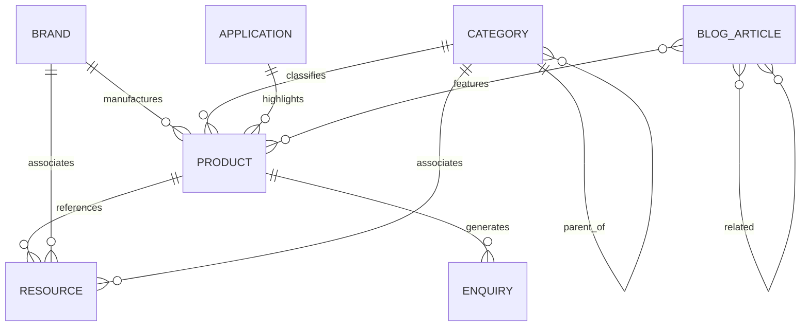

# CMS Data Architecture Specification (Stage 8)

> **Document Status**: Complete & Aligned with Phase 4 Admin Prototypes  
> **Target CMS**: Strapi Headless CMS (v5 / v4 compatible)  
> **Database Engine**: PostgreSQL 16+  
> **Target Object Storage**: S3-compatible bucket + CDN distribution  
> **Frontend Consumer**: Next.js 16 (App Router) with typed fetchers (`src/lib/cms`)

---

## 1. Architecture Overview & Entity Relationships

The data model is engineered around a **hybrid B2B catalog and inquiry pipeline**. A single technical resource (manual, certificate, brochure) or brand entity can relate to multiple products or categories without duplicating files.

---

## 2. Content Type Schemas

### 2.1. Product (`api::product.product`)
*Collection Type — Core scientific product catalog item.*

| Field | Type | Required | Constraints / Validation | Notes |
| :--- | :--- | :--- | :--- | :--- |
| `title` | String | Yes | Max 255 chars | e.g. "LABXE Micropipette Single Channel" |
| `slug` | UID | Yes | Target: `title`, unique | e.g. `labxe-precision-variable-100-1000` |
| `sku` | String | Yes | Unique, uppercase | e.g. `LABXE-SP-001` |
| `brand` | Relation (M2O) | Yes | Target: `api::brand.brand` | One of `LABXE`, `SSCIENCES`, `DANWER` |
| `category` | Relation (M2O) | Yes | Target: `api::category.category` | Top-level category |
| `subcategory` | Relation (M2O) | No | Target: `api::category.category` | Child category (e.g. Variable Volume) |
| `channelType` | Enumeration | No | `Single Channel`, `8-Channel`, `12-Channel`, `None` | Product hardware channel configuration |
| `mechanism` | Enumeration | Yes | `Mechanical (Manual)`, `Electronic (Motorized)` | Pipetting drive type |
| `volumeRangeMin` | Decimal | No | >= 0 | Minimum microliter volume (e.g. 0.1) |
| `volumeRangeMax` | Decimal | No | > volumeRangeMin | Maximum microliter volume (e.g. 1000) |
| `volumeUnit` | Enumeration | No | `µL`, `mL` | Default: `µL` |
| `autoclavability` | Enumeration | Yes | `Fully Autoclavable`, `Autoclavable Lower Assembly`, `Non-autoclavable` | ISO 8655 sterilization compliance |
| `overview` | Text | Yes | Short summary (100–350 chars) | Displayed on product cards & summary |
| `features` | JSON / Component | No | Array of strings | Key bulleted product advantages |
| `specifications` | Component (Repeatable) | Yes | `{ label: string, value: string }` | Technical table (accuracy, CV%, tip fit) |
| `images` | Media (Multiple) | Yes | Formats: `.webp`, `.jpg`, `.png` | Product photo gallery |
| `resources` | Relation (M2M) | No | Target: `api::resource.resource` | Linked datasheets, manuals, certificates |
| `relatedProducts`| Relation (M2M) | No | Target: `api::product.product` | Cross-sell / alternative volume models |
| `displayOrder` | Integer | No | Default: 100 | Catalog sort index |
| `seo` | Component | No | Target: `shared.seo` | Page-specific title, meta desc, canonical |
| `status` | Draft/Publish | Yes | Strapi core editorial | Draft / Published |

---

### 2.2. Category (`api::category.category`)
*Collection Type — Hierarchical product taxonomy.*

| Field | Type | Required | Constraints | Notes |
| :--- | :--- | :--- | :--- | :--- |
| `name` | String | Yes | Max 100 chars | e.g. "Micropipettes", "Bottle Top Dispensers" |
| `slug` | UID | Yes | Target: `name`, unique | e.g. `micropipettes`, `bottle-top-dispensers` |
| `parent` | Relation (M2O) | No | Target: `api::category.category` | Self-referencing parent category |
| `children` | Relation (O2M) | No | Target: `api::category.category` | Inverted relation for subcategories |
| `description` | Text | No | Max 500 chars | Category summary for catalog banner |
| `bannerImage` | Media (Single) | No | Image asset | Header background image |
| `displayOrder` | Integer | Yes | Default: 1 | Navigation sort order |
| `seo` | Component | No | Target: `shared.seo` | Category SEO meta |

---

### 2.3. Brand (`api::brand.brand`)
*Collection Type — Verified brand portfolios.*

| Field | Type | Required | Constraints | Notes |
| :--- | :--- | :--- | :--- | :--- |
| `name` | Enumeration | Yes | `LABXE`, `SSCIENCES`, `DANWER` | Strict confirmed brand scope |
| `tagline` | String | Yes | Max 150 chars | e.g. "Technology For Better Science." |
| `slug` | UID | Yes | Target: `name`, unique | `labxe`, `ssciences`, `danwer` |
| `summary` | Text | Yes | Multi-paragraph overview | Brand story and manufacturing focus |
| `logo` | Media (Single) | Yes | Vector SVG / transparent PNG | Brand identity mark |
| `bannerImage` | Media (Single) | No | Image asset | Brand hero background |
| `displayOrder` | Integer | Yes | Default: 1 | Listing display sequence |
| `products` | Relation (O2M) | No | Target: `api::product.product` | Products under this brand |
| `seo` | Component | No | Target: `shared.seo` | Brand landing page SEO |

---

### 2.4. Resource (`api::resource.resource`)
*Collection Type — Central document repository.*

| Field | Type | Required | Constraints | Notes |
| :--- | :--- | :--- | :--- | :--- |
| `title` | String | Yes | Max 200 chars | e.g. "Liquid Handling Master Catalogue" |
| `type` | Enumeration | Yes | `Catalogue`, `Brochure`, `Datasheet`, `Manual`, `Certificate`, `Calibration-related`, `Other` | Resource classification |
| `file` | Media (Single) | Yes | Allowed: `.pdf`, `.doc`, `.docx` | S3-hosted downloadable document |
| `downloadLabel` | String | No | Default: "Download Document" | CTA button label |
| `brands` | Relation (M2M) | No | Target: `api::brand.brand` | Associated brand(s) |
| `categories` | Relation (M2M) | No | Target: `api::category.category` | Associated category(ies) |
| `products` | Relation (M2M) | No | Target: `api::product.product` | Associated product(s) |
| `isGated` | Boolean | Yes | Default: `false` | If true, prompts for user email before download |

---

### 2.5. Blog Article (`api::blog-article.blog-article`)
*Collection Type — Scientific insights, guides, and SEO content.*

| Field | Type | Required | Constraints | Notes |
| :--- | :--- | :--- | :--- | :--- |
| `title` | String | Yes | Max 255 chars | e.g. "ISO 8655 Gravimetric Testing Explained" |
| `slug` | UID | Yes | Target: `title`, unique | e.g. `iso-8655-gravimetric-testing-explained` |
| `category` | String | Yes | Max 60 chars | e.g. "Liquid Handling", "Product Guidance" |
| `author` | String | Yes | Max 100 chars | Author or editorial credit |
| `publishDate` | Date | Yes | ISO format (`YYYY-MM-DD`) | Display date |
| `readingTime` | String | No | e.g. "5 min read" | Reading duration |
| `excerpt` | Text | Yes | Max 350 chars | Summary for listing card and OpenGraph |
| `content` | Rich Text / Blocks | Yes | Markdown / Strapi Blocks | Full article body with H2/H3 for TOC |
| `featuredImage` | Media (Single) | Yes | Image asset | Article banner |
| `tags` | JSON | No | Array of strings | e.g. `["micropipette", "calibration"]` |
| `faq` | Component (Repeatable) | No | `{ question: string, answer: string }` | Optional article-specific FAQ |
| `relatedProducts`| Relation (M2M) | No | Target: `api::product.product` | Embedded product recommendation cards |
| `seo` | Component | No | Target: `shared.seo` | Page-specific SEO |

---

### 2.6. Application (`api::application.application`)
*Collection Type — Scientific industry workflows.*

| Field | Type | Required | Constraints | Notes |
| :--- | :--- | :--- | :--- | :--- |
| `name` | String | Yes | Max 100 chars | e.g. "Molecular Biology", "Genomics" |
| `slug` | UID | Yes | Target: `name`, unique | e.g. `molecular-biology` |
| `summary` | Text | Yes | Max 300 chars | Application description |
| `icon` | String | No | Icon identifier | SVG icon name |
| `displayOrder` | Integer | Yes | Default: 1 | Discovery grid order |
| `products` | Relation (M2M) | No | Target: `api::product.product` | Applicable pipettes and consumables |

---

### 2.7. FAQ (`api::faq.faq`)
*Collection Type — Global and category-associated FAQs.*

| Field | Type | Required | Constraints | Notes |
| :--- | :--- | :--- | :--- | :--- |
| `question` | String | Yes | Max 255 chars | Question statement |
| `answer` | Text | Yes | Markdown-supported | Verified technical answer |
| `category` | Enumeration | Yes | `General`, `Products`, `OEM`, `Calibration`, `Shipping` | Filter group |
| `displayOrder` | Integer | Yes | Default: 1 | Display sequence |

---

### 2.8. Enquiry (`api::enquiry.enquiry`)
*Collection Type — Incoming B2B quote and contact requests.*

| Field | Type | Required | Constraints | Notes |
| :--- | :--- | :--- | :--- | :--- |
| `name` | String | Yes | Max 120 chars | Contact person |
| `email` | Email | Yes | Valid email format | Contact email address |
| `phone` | String | No | Phone number | Optional country-code telephone |
| `company` | String | Yes | Max 150 chars | Organization / Institution |
| `country` | String | Yes | Max 80 chars | Country of destination |
| `type` | Enumeration | Yes | `Product Quote`, `Universal / General`, `OEM / Private Label`, `Technical Resource` | Distinct enquiry channel |
| `product` | String | No | Product title or SKU | Set if product-specific quote |
| `quantity` | String | No | e.g. "50 units" | Estimated order volume |
| `message` | Text | Yes | Multi-line text | Specific user requirement |
| `oemSpecifications` | Text | No | Detailed OEM specs | Custom branding, colors, volume ranges |
| `status` | Enumeration | Yes | `New`, `Open`, `Responded`, `Closed` | Admin workflow status |
| `internalNotes` | Text | No | Internal only | Admin notes (never exposed to public API) |

---

### 2.9. Settings (`api::setting.setting`)
*Single Type — Global website identity, SEO defaults, and contact points.*

| Field | Type | Required | Notes |
| :--- | :--- | :--- | :--- |
| `siteName` | String | Yes | "MicropipetteManufacturer.com" |
| `siteTagline` | String | Yes | "Precision. Performance. Partnership." |
| `defaultDescription` | Text | Yes | Fallback search description |
| `defaultTitlePattern` | String | Yes | `{page_title} \| MicropipetteManufacturer.com` |
| `defaultRobots` | String | Yes | "Index, follow" |
| `contactEmail` | Email | Yes | "sales@micropipettemanufacturer.com" |
| `contactPhone` | String | Yes | "+91 98200 00000" |
| `address` | Text | Yes | Manufacturing plant address |
| `linkedin` | URL | No | Official LinkedIn URL |
| `twitter` | URL | No | Official Twitter/X URL |

---

### 2.10. Shared Component: SEO (`shared.seo`)

| Field | Type | Required | Notes |
| :--- | :--- | :--- | :--- |
| `metaTitle` | String | No | Target length: 50–65 chars |
| `metaDescription` | Text | No | Target length: 120–160 chars |
| `canonicalUrl` | String | No | Custom canonical override |
| `robotsDirective` | String | No | e.g. `noindex, nofollow` |
| `shareImage` | Media (Single) | No | OpenGraph / Twitter card image |
| `schemaJson` | JSON | No | Optional custom JSON-LD schema snippet |

---

## 3. Database Indexing Strategy (PostgreSQL)

To ensure sub-millisecond query execution in production:

1. **Unique Indexes**:
   * `products.slug`, `products.sku`
   * `categories.slug`
   * `brands.slug`
   * `blog_articles.slug`
   * `applications.slug`
2. **Foreign Key Indexes**:
   * `products.brand_id`, `products.category_id`
   * `categories.parent_id`
   * `enquiries.created_at`, `enquiries.status`
3. **Full-Text Search Index (GIN)**:
   * `to_tsvector('english', products.title || ' ' || products.overview)`

---

## 4. API Security & Role-Based Access Control (RBAC)

* **Public Role (`api::*`)**:
  * Allowed: `find`, `findOne` on Products, Categories, Brands, Resources, Articles, Applications, FAQs, Settings.
  * Allowed: `create` on `api::enquiry.enquiry` (rate-limited and spam-screened).
  * Denied: All `update`, `delete`, or internal note reading.
* **Server-to-Server Token (`CMS_API_TOKEN`)**:
  * Used by Next.js Server Components for Incremental Static Regeneration (ISR) and Draft Mode previews.
